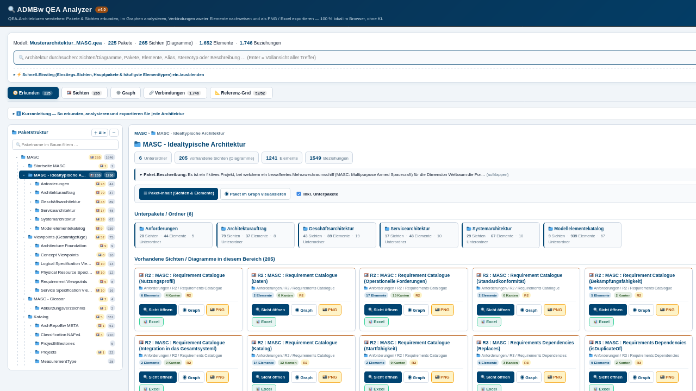
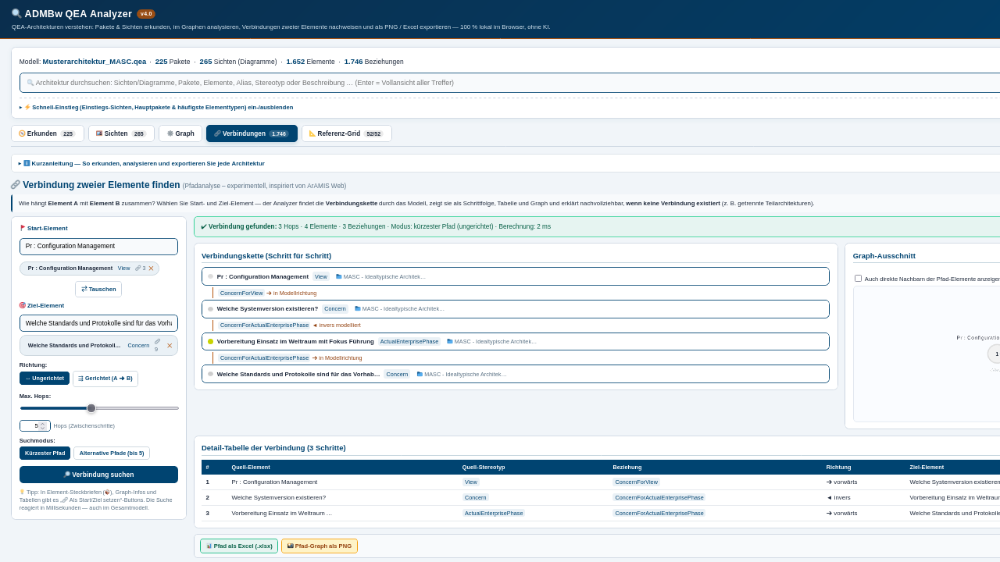
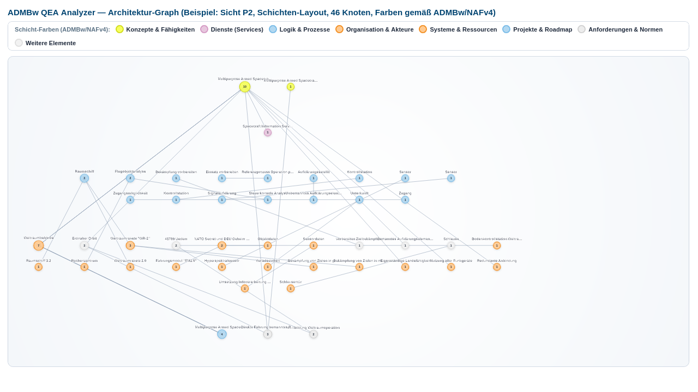

# ADMBw QEA Analyzer

**QEA-Architekturen niederschwellig analysieren — 100 % lokal im Browser, ohne KI, ohne Installation.**

Einzeldatei-Tool (HTML & ASPX) zur Analyse von Sparx-EA-Architekturmodellen (`.qea` / `.eapx` / `.qeax`):
Pakete & Sichten erkunden · Gesamtzusammenhang im Graphen analysieren · **Verbindungen zweier Elemente nachweisen** (ArAMIS-inspiriert) · jede Sicht als **PNG oder Excel (.xlsx)** exportieren. Knoten-Farben gemäß **ADMBw/NAFv4**.



---

## Funktionen

* **🧭 Erkunden** — realer Paketbaum (t_package) mit allen tatsächlich vorhandenen Sichten (t_diagram), Elementen und Beziehungen. Auch Modelle **ohne** ADMBw-Namenskonvention werden vollständig angezeigt.
* **🔍 Sofort-Suche** — globale Live-Suche über Sichten, Pakete und Elemente (Name, Alias, Stereotyp, Beschreibung) mit Ergebnis-Vollansicht.
* **🕸️ Graph** — interaktive Netzwerk-/Schichten-/Radial-Darstellung; Knotenzahl stufenlos per **Schieberegler oder manueller Zahleneingabe**; Farb-Legende nach ADMBw/NAFv4.
* **🔗 Verbindungen (Pfadanalyse, experimentell)** — Start- und Ziel-Element wählen: Der Analyzer findet die Verbindungskette (kürzester Pfad oder bis zu 5 Alternativen, gerichtet/ungerichtet, max. 1–10 Hops), zeigt sie als **Schritt-Kette, Tabelle und Graph-Ausschnitt** — und liefert bei fehlender Verbindung eine **Architektur-Diagnose** (getrennte Teilarchitekturen, Erreichbarkeit, gemeinsame Nachbarn). Inspiriert von ArAMIS Web (/ AAroN-Neo4j).
* **📸 / 📊 1-Klick-Export** — jede einzelne Sicht, jedes Paket, jeder Graph und jede Pfadanalyse als hochauflösendes **PNG** (mit Bw-Kopfzeile) oder als echte, mehrblättrige **Excel-Arbeitsmappe (.xlsx)** — komplett offline erzeugt.
* **🎨 ADMBw/NAFv4-Farben** — Elemente in den offiziellen Schichtfarben (Konzepte, Services, Logik, Ressourcen, Anforderungen) → Details: [docs/ADMBw-Farben.md](docs/ADMBw-Farben.md)
* **🔒 Zero-Data-Leakage** — die QEA-Datei wird ausschließlich im Browser verarbeitet; es findet **keinerlei** Datenübertragung statt. Kein CDN, keine Bibliotheken, kein Build-Schritt.




---

## Schnellstart

1. `dist/ADMBw_QEA_Analyzer.html` herunterladen (oder direkt vom GitHub-Repo öffnen: *Raw → Datei speichern*).
2. Per Doppelklick im Browser öffnen (Edge/Chrome/Firefox aktuell).
3. QEA-/EAPX-Datei per Drag & Drop auf die Startseite ziehen — fertig.

Für Pfadanalyse und Graph gibt es keinen Server, keine Installation und keine Netzabhängigkeit.

## Deployment bei der Bundeswehr (SharePoint)

Es liegen **zwei identische Varianten** bei:

| Datei | Verwendung |
|---|---|
| `dist/ADMBw_QEA_Analyzer.html` | Lokale Nutzung (Doppelklick) oder SharePoint-Dokumentbibliothek |
| `dist/ADMBw_QEA_Analyzer.aspx` | SharePoint-/IIS-Bibliothek (eine Zeile *kürzer* als die HTML: beginnt direkt mit `<!DOCTYPE html>`) |

> **Wichtig (Vorgabe 10/2026):** Die ASPX-Datei beginnt **direkt mit `<!DOCTYPE html>`** — es wird **keine** `<%@ Page … %>`-Direktive vorangestellt. Beide Dateien sind **UTF-8 mit BOM** (sonst Mojibake „ä/ö/ü") und enthalten keine `<%`-Sequenzen.

Schritt-für-Schritt-Anleitung: [docs/SharePoint-Deployment.md](docs/SharePoint-Deployment.md)

---

## Testmodell

Zum Ausprobieren eignet sich die öffentliche Musterarchitektur **MASC** aus dem Begleit-Repo:
`https://github.com/Mitchel85/eam-qea-tool` → `Demo-Output/Musterarchitektur_MASC.qea` (225 Pakete, 265 Sichten, 1.652 Elemente, 1.746 Beziehungen).

## Build aus Quellen

Die Anwendung ist eine einzige HTML-Datei; die Quellen liegen modular in `src/`:

```
src/part1_head_body.html   Struktur & Design (CSS, Reiter, Ansichten)
src/part2_app_core.js      Kern: Modell-Parser-Aufsatz, Suche, Exporte (PNG/XLSX/CSV)
src/part3_app_graph.js     Diagramme, Steckbriefe, interaktiver Graph
src/part4_path.js          Verbindungs-/Pfadanalyse (BFS, Alternativpfade, Diagnose)
src/build_release.py       Assembler: baut HTML + ASPX (+ node --check)
```

```bash
python3 src/build_release.py   # Pfade im Skript ggf. anpassen
```

Das Skript prüft alle Script-Blöcke mit `node --check`, stellt sicher, dass keine `<%`-Sequenz enthalten ist, und schreibt die ASPX mit BOM.

## Technische Eckdaten

* **Vanilla-JS (ES5)** — läuft auch in restriktiven/älteren Umgebungen, keine externen Bibliotheken.
* **Einzeldatei** ~293 KB, komplett offline; Graph- und Pfadberechnung auf ~2.000 Knoten in **< 15 ms**.
* Getestet mit `Musterarchitektur_MASC.qea`: 225 Pakete · 265 Sichten · 1.652 Elemente · 1.746 Beziehungen · Exporte in Excel (openpyxl-validiert) und PNG.

## Changelog

### v4.0 — 15.10.2026
* **Umbenennung:** „ADMBw Architektur- & Viewpoint-Explorer" → **ADMBw QEA Analyzer** (Fokus: QEA-Dateien niederschwellig analysieren, ohne KI).
* **Oberfläche aufgeräumt:** 5 klar benannte Reiter (Erkunden · Sichten · Graph · Verbindungen · Referenz-Grid), kontextnahe Exporte statt globaler Buttonleiste, eingeklappte Hilfen.
* **NEU: Verbindungs-/Pfadanalyse** (ArAMIS-inspiriert) inkl. Architektur-Diagnose bei fehlender Verbindung.
* **Neu: Knoten-Farben gemäß ADMBw/NAFv4** (offizielle Farblegende; auch in Diagrammen und Exporten).
* ASPX ohne `<%@ Page %>`-Direktive (startet direkt mit `<!DOCTYPE html>`).

### v3.0 — 14.10.2026
* Search-First-Oberfläche, Paket- & Sichten-Explorer, natives `.xlsx`/PNG-Export je Sicht, Graph mit manueller Knotenzahl + Slider, 3 Layouts.

*(Autor: Michael Estel · )*
